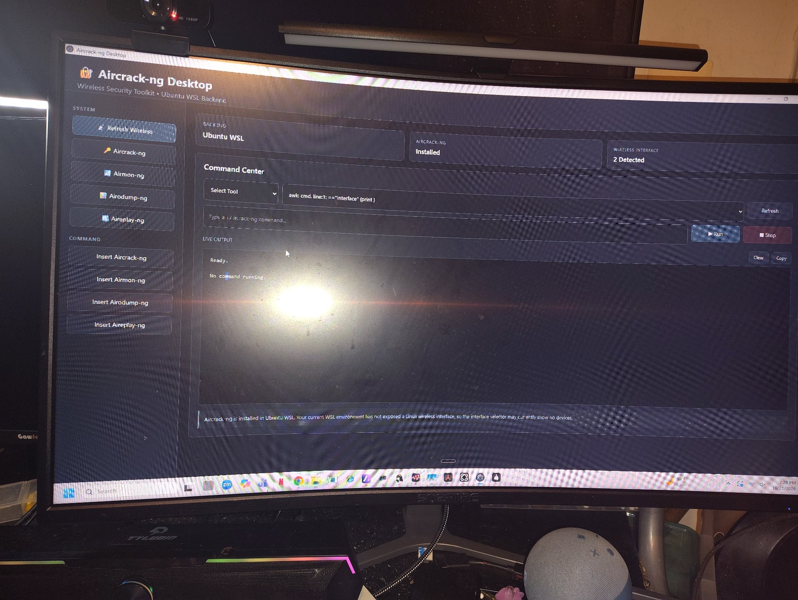

# Aircrack-ng Desktop

**A desktop command center for the Aircrack-ng wireless security suite** — a Windows front-end that drives the real Aircrack-ng tools running in an Ubuntu WSL backend, with one-click tool launchers, command templates, and a live output console. Built for wireless security auditing practice in a home lab.

## Overview

The Aircrack-ng suite (`aircrack-ng`, `airmon-ng`, `airodump-ng`, `aireplay-ng`) is powerful and entirely command-line — and on a Windows machine it means juggling a WSL terminal, remembering tool syntax, and losing your output in scrollback. Aircrack-ng Desktop wraps that workflow in a point-and-click command center: status cards tell you the state of the backend and your wireless interfaces, templates insert correct tool syntax, and every command's output streams into a console you can stop, clear, and copy.

- **Form factor:** Windows desktop application with an Ubuntu WSL backend
- **Repository type:** project showcase — a compiled build is available on request; application source code is not published in this repository

## Screenshot



*The command center: Ubuntu WSL backend detected, Aircrack-ng suite installed, wireless interfaces reported, tool launchers on the left, live output console in the center — including the app's own honest notice that the WSL environment has not exposed a Linux wireless interface.*

## Features

- **Backend detection** — on launch the app probes for its Ubuntu WSL backend and reports it on a status card, so you know the execution environment is alive before you run anything.
- **Tool availability checks** — the suite's installation state is verified and displayed ("Aircrack-ng: Installed"), rather than letting the first real command fail with a not-found error.
- **Wireless interface reporting** — a status card reports detected wireless interfaces, and the app states plainly when the WSL environment has not exposed a usable Linux wireless interface (see *Known limitations*).
- **One-click tool launchers** — sidebar buttons for `aircrack-ng`, `airmon-ng`, `airodump-ng`, and `aireplay-ng`, plus a **Refresh Wireless** action to re-scan the interface state.
- **Command templates** — "Insert …" buttons drop the correct invocation skeleton for each tool into the command bar, so the syntax is right and you only fill in the target parameters.
- **Free-form command execution** — type or edit any suite command, then **Run** / **Stop** it from the console controls.
- **Live output streaming** — command output streams into the console as it happens (not after the process exits), with **Clear** and **Copy** controls for capturing results into notes or a report.

## Architecture

Aircrack-ng Desktop is split across two environments, on purpose:

- **Electron desktop interface (Windows)** — the shell owns the window, the dashboard (backend / suite / interface status cards), the tool launcher sidebar, the command bar, and the live output console. It reimplements **none** of the security tools.
- **Ubuntu WSL backend** — the real Aircrack-ng suite, installed in an Ubuntu distribution under WSL. When you run a command, the shell dispatches it into the WSL environment for execution — the same binaries, the same behavior as a Linux terminal.
- **Streaming bridge** — the backend process's stdout/stderr are streamed back into the console in real time, and **Stop** terminates the dispatched process. Detection works the same way in reverse: the status cards are populated by probing the WSL backend (distribution present? suite binaries on PATH? wireless interfaces visible to Linux?) and rendering the results.

This design keeps the tooling genuine — captures, handshakes, and key recovery are done by the upstream suite, untouched — while making it operable from a Windows desktop.

## Setup

1. **Windows 10/11** with **WSL2** enabled and an **Ubuntu** distribution installed (`wsl --install -d Ubuntu` from an elevated terminal, if you don't have one yet).
2. Install the suite inside Ubuntu:
   ```bash
   sudo apt update && sudo apt install aircrack-ng
   ```
3. For actual monitor-mode capture work, attach a **USB wireless adapter** that has Linux driver support and pass it through to WSL (e.g. with `usbipd-win`) — the host's built-in Wi-Fi adapter cannot be used (see *Known limitations*).
4. Obtain the compiled desktop build — available on request from the author — and run it. The status cards should report **Ubuntu WSL**, **Aircrack-ng: Installed**, and your interface state.

### Dependencies

| Dependency | Notes |
|---|---|
| Windows 10/11 (x64) | Host for the desktop shell |
| WSL2 + Ubuntu | The execution backend; WSL1 is not suitable for this workflow |
| Aircrack-ng suite | Installed in the Ubuntu backend (`aircrack-ng` package) |
| USB wireless adapter (for capture work) | Must support monitor mode with a Linux driver; passed through to WSL |

## Usage

1. Launch the app and check the status cards: backend up, suite installed, interfaces reported.
2. Use **Refresh Wireless** after attaching or re-attaching an adapter.
3. Pick a tool from the sidebar, or use an **Insert …** template to start from correct syntax.
4. Fill in the target parameters, **Run**, and watch the live console. **Stop** ends a long-running capture; **Copy** lifts the output into your notes.
5. Work only against networks you own or are authorized to test — see below.

## Authorized use

This toolkit is for **security auditing and education on networks you own or have explicit, written authorization to test** — a home lab, your own equipment, or an engagement with permission. Capturing traffic from, deauthenticating, or attempting to recover keys for networks you don't own or aren't authorized to test is illegal in most jurisdictions (e.g. the U.S. Computer Fraud and Abuse Act) and is not what this project is for.

## Known limitations

- **WSL2 does not pass the host's built-in Wi-Fi adapter through as a Linux wireless interface.** Windows owns the internal adapter; Linux inside WSL sees no `wlan` device from it, so monitor mode and packet injection against the internal card are impossible. Full capture work requires a USB wireless adapter with Linux monitor-mode support passed through to WSL (e.g. via `usbipd-win`). The app detects this state and reports it — the notice in the screenshot ("Your current WSL environment has not exposed a Linux wireless interface") is that detection working as designed, not an error.
- **Interface counts can include virtual/WSL networking devices** that are not usable wireless capture interfaces; a detected count is a starting point, not a guarantee of a monitor-mode-capable device.
- **Showcase repository** — this repo documents the project and hosts its screenshot; it does not contain the application source or a downloadable release.

## Troubleshooting

- **Backend card doesn't show Ubuntu WSL** — confirm WSL is installed and the Ubuntu distribution starts (`wsl -d Ubuntu` in a terminal). First launch of a fresh distribution can require completing its initial user setup.
- **"Aircrack-ng: Not installed"** — install the suite in the Ubuntu backend: `sudo apt update && sudo apt install aircrack-ng`, then re-check.
- **No wireless interfaces / interface selector empty** — expected with only the host's built-in adapter (see *Known limitations*). Attach a Linux-compatible USB adapter and pass it through to WSL, then **Refresh Wireless**.
- **A command fails immediately** — read the console output first: the suite's own error is streamed back verbatim. Most failures are a missing tool (above), a missing interface, or a mistyped parameter in an otherwise correct template.

### Known issue: awk quoting error in the interface check

**Symptom** — the command bar shows:

```text
awk: cmd. line:1: =="interface" {print }
```

**Root cause** — the wireless-interface detection pipeline runs an `awk` program that references awk's first field, `$1` (comparing it against `"interface"`). That command string is assembled inside double quotes / a JavaScript template literal before being dispatched to the backend. In that context, `$1` is consumed by interpolation — treated as a shell/template placeholder and replaced (with nothing) — before `awk` ever receives it. What reaches `awk` is the program with the field reference stripped out: `=="interface" {print }`, which is a syntax error, and `awk` reports it exactly as shown.

**Corrected pattern** — keep the `awk` program out of interpolation:

- Single-quote the awk program so nothing inside it is expanded:
  ```bash
  awk '$1 == "interface" {print}'
  ```
- Or, when the command must be assembled inside double quotes / a template literal, escape the dollar sign so `$1` survives to `awk`:
  ```bash
  awk "\$1 == \"interface\" {print}"
  ```

**Status** — diagnosed and documented here; the in-app patch ships with the next build. The workaround in the meantime is cosmetic: the error appears in the command bar, and interface detection falls back to the app's other probes (the status cards in the screenshot reflect detected state despite it).

## License

**License: TBD by author** — no license file is included in this repository yet; all rights are reserved by the author until one is added. The Aircrack-ng suite itself is a separate open-source project (GPL) by its own authors; this desktop front-end is an independent wrapper and is not affiliated with the Aircrack-ng project.
